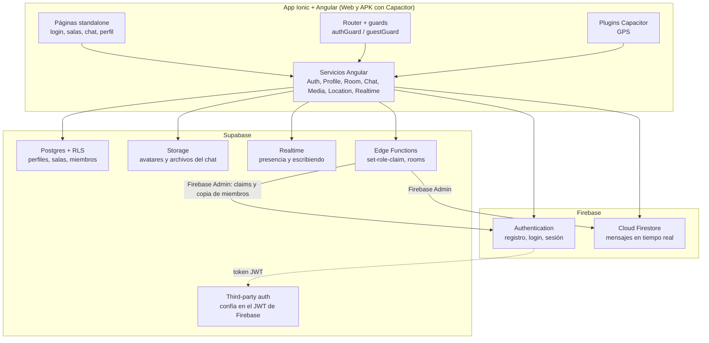
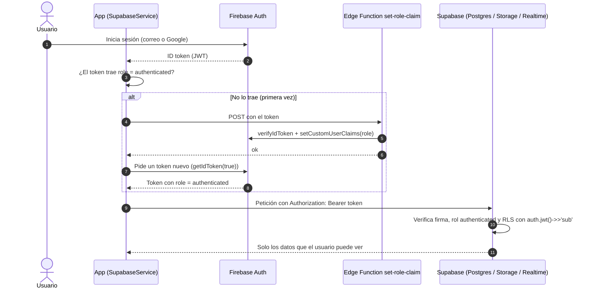
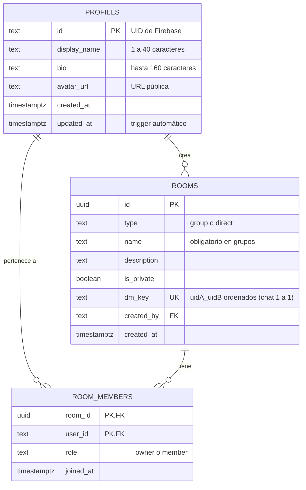
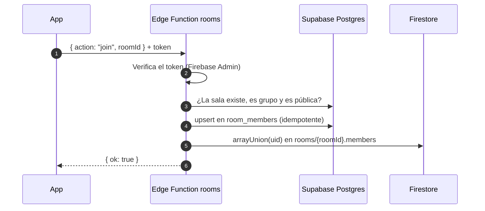
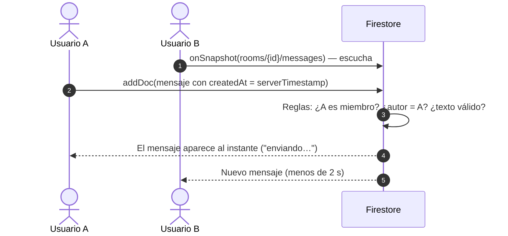
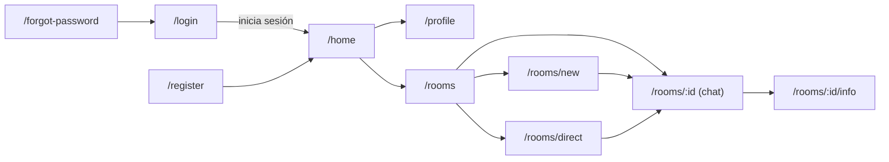

# Chat EPN — Aplicación de chat con Firebase y Supabase

Aplicación de mensajería multiplataforma (web y Android) construida con **Ionic + Angular** que integra **Firebase** y **Supabase al mismo tiempo**, aprovechando lo mejor de cada servicio: Firebase gestiona la identidad y los mensajes en tiempo real; Supabase gestiona los datos relacionales, los archivos y la presencia de usuarios.

| | |
| --- | --- |
| **Integrante** | _(completar con nombre completo)_ |
| **Modalidad** | Trabajo individual |
| **Aplicación web** | _(completar con la URL de Firebase Hosting)_ |
| **APK** | _(completar con el enlace de descarga)_ |
| **Video demostrativo** | _(completar con el enlace de la red social)_ |

---

## Tabla de contenidos

1. [Funcionalidades](#1-funcionalidades)
2. [Capturas de pantalla](#2-capturas-de-pantalla)
3. [Tecnologías](#3-tecnologías)
4. [Arquitectura](#4-arquitectura)
5. [Cómo se usan Firebase y Supabase](#5-cómo-se-usan-firebase-y-supabase)
6. [Modelo de datos](#6-modelo-de-datos)
7. [Flujos principales](#7-flujos-principales)
8. [Seguridad](#8-seguridad)
9. [Estructura del proyecto](#9-estructura-del-proyecto)
10. [Flujo de desarrollo](#10-flujo-de-desarrollo)
11. [Cómo ejecutar el proyecto](#11-cómo-ejecutar-el-proyecto)
12. [Pendientes](#12-pendientes)

---

## 1. Funcionalidades

| # | Funcionalidad | Servicio que la resuelve | Estado |
| --- | --- | --- | --- |
| F01 | Registro con correo y contraseña | Firebase Authentication | ✅ |
| F02 | Inicio y cierre de sesión, sesión persistente | Firebase Authentication | ✅ |
| F03 | Inicio de sesión con Google | Firebase Authentication | ✅ Web · ⏳ Android |
| F04 | Recuperar contraseña por correo | Firebase Authentication | ✅ |
| F05 | Ver y editar perfil (nombre y biografía) | Supabase Postgres | ✅ |
| F06 | Foto de perfil | Supabase Storage (bucket público) | ✅ |
| F07 | Crear salas de grupo públicas o privadas | Supabase Postgres + Edge Function | ✅ |
| F08 | Unirse, salir, ver y agregar miembros | Supabase Postgres + Edge Function | ✅ |
| F09 | Chat privado 1 a 1 sin duplicados | Supabase Postgres + Edge Function | ✅ |
| F10 | Mensajes de texto en tiempo real | Cloud Firestore | ✅ |
| F11 | Editar y eliminar mensajes propios | Cloud Firestore | ✅ |
| F12 | Enviar imágenes | Supabase Storage (bucket privado) + Firestore | ✅ |
| F13 | Enviar archivos (PDF, Word, Excel…) | Supabase Storage (bucket privado) + Firestore | ✅ |
| F14 | Compartir ubicación con mapa | Capacitor Geolocation + Leaflet + Firestore | ✅ |
| F15 | Usuarios en línea | Supabase Realtime (Presence) | ✅ |
| F16 | Indicador "escribiendo…" | Supabase Realtime (Broadcast) | ✅ |
| F17 | Búsqueda de personas para iniciar un chat | Supabase Postgres | ✅ |
| F18 | Notificaciones push | Firebase Cloud Messaging | ⏳ |

---

## 2. Capturas de pantalla

> Completar con capturas reales de la aplicación (web y Android).

| Inicio de sesión | Salas | Chat | Perfil |
| --- | --- | --- | --- |
| _(captura)_ | _(captura)_ | _(captura)_ | _(captura)_ |

| Imagen y archivo | Ubicación | Chat 1 a 1 | En línea / escribiendo |
| --- | --- | --- | --- |
| _(captura)_ | _(captura)_ | _(captura)_ | _(captura)_ |

---

## 3. Tecnologías

| Capa | Tecnología | Versión | Para qué se usa |
| --- | --- | --- | --- |
| Interfaz | Ionic Framework | 9 | Componentes visuales móviles (listas, botones, pestañas, modales) |
| Framework | Angular (standalone, zoneless, OnPush) | 22 | Estructura de la app, rutas, inyección de dependencias, signals |
| Lenguaje | TypeScript | 6 | Tipado estático de todo el código |
| Nativo | Capacitor | 8 | Empaquetar la web como APK y acceder al GPS |
| Identidad y mensajes | Firebase (SDK JS modular) | 13 | Authentication y Cloud Firestore |
| Datos, archivos y tiempo real | Supabase (`supabase-js`) | 2 | Postgres con RLS, Storage, Realtime y Edge Functions |
| Servidor | Supabase Edge Functions (Deno) + Firebase Admin | — | Lógica que no puede ejecutar el cliente |
| Mapas | Leaflet + OpenStreetMap | 1.9 | Mapa de ubicación sin clave de API |
| Entorno | Node.js · Ionic CLI · Firebase CLI · Android Studio | 26 LTS | Desarrollo, despliegue y compilación del APK |

---

## 4. Arquitectura

La app es una sola base de código web que se ejecuta en el navegador y, empaquetada con Capacitor, dentro de un APK. Internamente se organiza en capas: **las páginas solo muestran datos** y **los servicios son la única puerta hacia Firebase y Supabase**.



### Decisiones de arquitectura

| Decisión | Motivo |
| --- | --- |
| **Un solo login (Firebase) para los dos backends** | Supabase acepta el token de Firebase mediante *Third-party auth*; el usuario nunca se registra dos veces |
| **Lecturas directas, escrituras sensibles por Edge Function** | Leer salas es rápido y lo filtra RLS. Crear salas o cambiar miembros pasa por un servidor que valida permisos y sincroniza Supabase y Firestore en el mismo paso |
| **Mensajes en Firestore, salas en Postgres** | Firestore está optimizado para escuchar cambios en tiempo real; Postgres, para relaciones (usuarios ↔ salas) y consultas con JOIN |
| **Archivos en Supabase Storage** | Políticas de acceso escritas con el mismo RLS de Postgres y sin requerir el plan de pago de Firebase |
| **Presencia y "escribiendo" en Supabase Realtime** | Son datos efímeros: no tiene sentido guardarlos en una base de datos |
| **SDK de Firebase sin AngularFire** | Evita depender de que AngularFire publique una versión compatible con cada versión nueva de Angular |
| **Signals para todo el estado visible** | Angular 22 es *zoneless* y *OnPush* por defecto: la pantalla solo se actualiza cuando un signal cambia |

---

## 5. Cómo se usan Firebase y Supabase

### Reparto de responsabilidades

| Necesidad | Firebase | Supabase |
| --- | --- | --- |
| Identidad de usuarios | ✅ Authentication (correo, Google, recuperación) | Verifica el token de Firebase (*Third-party auth*) |
| Mensajes del chat | ✅ Firestore `rooms/{id}/messages` | — |
| Perfiles de usuario | — | ✅ Tabla `profiles` |
| Salas y membresías | Copia de la lista de miembros (para sus reglas) | ✅ Tablas `rooms` y `room_members` (fuente de verdad) |
| Fotos de perfil | — | ✅ Bucket público `avatars` |
| Imágenes y archivos del chat | Metadatos del adjunto dentro del mensaje | ✅ Bucket privado `chat-media` con URLs firmadas |
| Usuarios en línea y "escribiendo" | — | ✅ Realtime (Presence + Broadcast) |
| Lógica de servidor | Firebase Admin (usado desde Supabase) | ✅ Edge Functions |
| Hosting de la web | ✅ Firebase Hosting | — |

### El puente entre los dos servicios

El punto clave de la integración es que **Firebase es el único dueño de las identidades** y Supabase solo verifica tokens:

1. El usuario inicia sesión en **Firebase Authentication** y recibe un **ID token** (JWT firmado por Google).
2. Cada petición a Supabase envía ese token. Supabase verifica la firma con las claves públicas de Google y lee el `sub` (UID de Firebase) para aplicar las políticas RLS.
3. Firebase no incluye el claim `role: authenticated` que Supabase necesita. Para resolverlo, la Edge Function **`set-role-claim`** usa Firebase Admin y agrega ese claim al usuario la primera vez que hace una petición.



---

## 6. Modelo de datos

### Postgres (Supabase)



| Tabla | Decisión de diseño |
| --- | --- |
| `profiles` | El `id` es el UID de Firebase (texto, no UUID). Todas las tablas se conectan con ese mismo identificador |
| `rooms` | Una sola tabla para grupos y chats 1 a 1 (`type`). `dm_key` con restricción `unique` garantiza que nunca existan dos chats entre las mismas dos personas |
| `room_members` | Tabla intermedia de la relación muchos a muchos. Clave primaria compuesta `(room_id, user_id)`: nadie se une dos veces a la misma sala |

### Firestore (Firebase)

| Ruta | Contenido | Quién escribe |
| --- | --- | --- |
| `rooms/{roomId}` | `members`: arreglo de UID (copia de `room_members`) | **Solo** la Edge Function `rooms` |
| `rooms/{roomId}/messages/{messageId}` | `authorId`, `type` (text, image, file, location), `text`, `file`, `location`, `createdAt`, `editedAt`, `deleted` | La app, validada por las reglas |

### Storage (Supabase)

| Bucket | Tipo | Ruta | Límite | Acceso |
| --- | --- | --- | --- | --- |
| `avatars` | Público | `<uid>/avatar.webp` | 1 MB, solo imágenes | Cada usuario escribe solo en su carpeta |
| `chat-media` | Privado | `<roomId>/<uuid>-<nombre>` | 10 MB, imágenes y documentos | Solo miembros de la sala; se lee con URLs firmadas que vencen en 1 hora |

---

## 7. Flujos principales

### Unirse a una sala (escritura doble Supabase + Firestore)

Las reglas de Firestore no pueden consultar Supabase, así que Firestore necesita su propia copia de los miembros. Esa copia la escribe **solo el servidor**, para que nadie pueda agregarse a una sala privada.



Las dos escrituras son **idempotentes**: si una falla, repetir la acción repara la diferencia sin duplicar datos.

### Enviar un mensaje en tiempo real



### Enviar una imagen o un archivo

1. La imagen se **reduce en el dispositivo** (máximo 1600 px, WebP), lo que además elimina los metadatos de ubicación de la foto.
2. Se sube al bucket privado `chat-media`, dentro de la carpeta de la sala.
3. Se crea el mensaje en Firestore con la ruta del archivo. Si este paso falla, el archivo recién subido se borra.
4. Quien abre el chat pide una **URL firmada** temporal para ver la imagen o descargar el archivo.

### Rutas de la aplicación



Las rutas públicas (`login`, `register`, `forgot-password`) usan `guestGuard`; todas las demás usan `authGuard`, que espera a que Firebase restaure la sesión antes de decidir.

---

## 8. Seguridad

La seguridad no depende de la interfaz: cada backend aplica sus propias reglas aunque alguien llame a la API directamente.

| Capa | Mecanismo | Qué garantiza |
| --- | --- | --- |
| Postgres | **RLS** + privilegios `GRANT` | Cada usuario edita solo su perfil; solo ve salas públicas o donde es miembro; la app no puede escribir salas directamente |
| Funciones auxiliares | Esquema `private` (no expuesto por la API) | `can_view_room` e `is_room_member` se usan en las políticas pero no son endpoints públicos |
| Storage | Políticas sobre `storage.objects` | Avatares: solo en la carpeta propia. Archivos del chat: solo miembros de la sala; solo el autor borra |
| Realtime | Canales privados + políticas sobre `realtime.messages` | Solo los miembros escuchan y envían en el canal `room:<id>` |
| Firestore | `firestore.rules` | Solo miembros leen y escriben mensajes; se valida autor, tipo, tamaño, adjuntos y ubicación; solo el autor edita o elimina |
| Edge Functions | Verificación con Firebase Admin | Cada acción usa el UID probado del token, nunca uno enviado por el cliente |

### Manejo de credenciales

| Credencial | ¿Pública? | Dónde vive |
| --- | --- | --- |
| Configuración web de Firebase (`apiKey`, `projectId`…) | Sí, está hecha para el cliente | `src/environments/environment*.ts` (**no** se suben al repositorio) |
| URL y *publishable key* de Supabase | Sí, protegida por RLS | `src/environments/environment*.ts` (**no** se suben) |
| Cuenta de servicio de Firebase | **No** | Secret `FIREBASE_SERVICE_ACCOUNT` en Supabase Edge Functions |
| Clave secreta de Supabase | **No** | Inyectada automáticamente por Supabase en las Edge Functions |

El repositorio solo incluye `environment.example.ts`, con los nombres de las variables y sin valores.

---

## 9. Estructura del proyecto

```
chat-app/
├── src/app/
│   ├── core/                 Lo que existe una sola vez en la app
│   │   ├── guards/           authGuard, guestGuard
│   │   ├── models/           Interfaces: perfil, sala, mensaje
│   │   ├── services/         Única puerta hacia Firebase y Supabase
│   │   └── utils/            Funciones puras: errores, imágenes, archivos
│   ├── features/             Una carpeta por área de la app
│   │   ├── auth/             Login, registro, recuperar contraseña
│   │   ├── profile/          Mi perfil
│   │   ├── rooms/            Lista, crear sala, nuevo chat, información
│   │   └── chat/             Pantalla del chat
│   └── shared/components/    Piezas visuales reutilizables (avatar, burbuja, mapa)
├── supabase/
│   ├── sql/                  Esquema de la base de datos, en orden (01 a 06)
│   └── functions/            Edge Functions: set-role-claim, rooms
├── firestore.rules           Reglas de seguridad de Firestore
└── android/                  Proyecto nativo generado por Capacitor
```

**Regla de dependencias:** `features` usa `core` y `shared`; `core` nunca importa nada de `features`; `shared` no habla con los backends (recibe todo por *inputs*).

---

## 10. Flujo de desarrollo

El proyecto se construyó por fases. Cada fase dejó algo que se podía probar contra criterios de aceptación antes de continuar, y terminó con un commit.

```mermaid
flowchart LR
    F0["0. Entorno"] --> F1["1. Proyecto base"] --> F2["2. Firebase"] --> F3["3. Autenticación"]
    F3 --> F4["4. Supabase"] --> F5["5. Perfiles"] --> F6["6. Salas"] --> F7["7. Mensajes"]
    F7 --> F8["8. Archivos"] --> F9["9. Ubicación"] --> F10["10. Tiempo real"] --> F13["13. Android"]
```



| Fase | Qué se construyó | Decisión o aprendizaje clave |
| --- | --- | --- |
| **0. Entorno** | Node 26 LTS (con nvm), Git, Ionic CLI, Firebase CLI, Android Studio, variables de entorno en Ubuntu | Con nvm los paquetes globales no necesitan `sudo`; Capacitor necesita `CAPACITOR_ANDROID_STUDIO_PATH` en Linux |
| **1. Proyecto base** | Plantilla Ionic 9 standalone, estructura `core` / `features` / `shared`, repositorio | En Ionic 9 los componentes se importan desde `@ionic/angular`; cada componente declara lo que usa en `imports` |
| **2. Firebase** | Proyecto, Firestore en modo producción, `FirebaseService`, claves fuera de Git | `initializeAuth` con IndexedDB en nativo para que Auth no se cuelgue dentro de Capacitor |
| **3. Autenticación** | `AuthService` con signals, guards, formularios reactivos, Google en web | `authStateReady()` evita expulsar al usuario al recargar; `inject()` siempre antes de cualquier `await` |
| **4. Supabase** | Third-party auth, `SupabaseService`, Edge Function `set-role-claim`, tabla `profiles` con RLS | El token de Firebase llegaba como `role: anon`; se resolvió asignando el claim desde una Edge Function con Firebase Admin |
| **5. Perfiles** | `ProfileService` con sincronización automática, edición, avatar en Storage | Un `upsert` sin `display_name` fallaba por `NOT NULL`: se separó en "crear" (upsert) y "editar" (update). Número de secuencia para resultados que llegan fuera de orden |
| **6. Salas** | Tablas `rooms` y `room_members`, Edge Function `rooms`, pantallas, chat 1 a 1 | Escritura doble Supabase + Firestore; función `security definer` para evitar recursión en RLS; Firestore Admin con `preferRest` porque gRPC se colgaba en Deno |
| **7. Mensajes** | `ChatService` con `onSnapshot`, editar y eliminar, reglas de Firestore | `effect` con `onCleanup` para cerrar escuchas; eliminación lógica ("Mensaje eliminado") |
| **8. Archivos** | Bucket privado `chat-media`, URLs firmadas, reducción de imágenes | Funciones auxiliares movidas a un esquema `private` para que no sean endpoints públicos |
| **9. Ubicación** | Capacitor Geolocation, Leaflet con OpenStreetMap | El mapa se crea en `afterNextRender` porque necesita que el elemento HTML ya exista |
| **10. Tiempo real** | Presencia y "escribiendo" con canales privados de Realtime | Datos efímeros en Realtime, no en una base de datos; *throttling* del aviso "escribiendo" |
| **13. Android** | Proyecto Capacitor, permisos de ubicación, APK de depuración | `appId` definitivo antes de crear el proyecto Android |

### Problemas encontrados y cómo se resolvieron

| Síntoma | Causa | Solución |
| --- | --- | --- |
| Las tablas de Supabase devolvían vacío sin error | El token de Firebase no traía `role`, así que las peticiones corrían como `anon` | Edge Function `set-role-claim` + renovación forzada del token |
| `FunctionsFetchError` al llamar a la función `rooms` | La función no estaba desplegada (404 sin cabeceras CORS) | Desplegarla con el nombre correcto y verificar con `curl` |
| La función `rooms` se quedaba colgada | Firebase Admin usa gRPC por defecto para Firestore | `initializeFirestore(app, { preferRest: true })` |
| Error 400 al guardar la foto de perfil | `upsert` valida la fila del INSERT antes del conflicto | Usar `update` para editar y `upsert` solo para crear |
| Las páginas nuevas no aparecían | El servidor de desarrollo no detectó las rutas diferidas nuevas | Reiniciar `ionic serve` y recargar sin caché |
| `rooms/new` abría el detalle de una sala llamada "new" | El router usa la primera ruta que coincide | Rutas fijas antes que las rutas con parámetros |

### Forma de trabajo

- **Una fase, un objetivo comprobable.** Cada fase se probó contra una tabla de criterios de aceptación (Dado / Cuando / Entonces) antes de avanzar.
- **Probar la seguridad sin la app.** Las políticas RLS se verificaron simulando usuarios en el SQL Editor (`set local role` + claims), y los resultados esperados incluían los casos que debían fallar.
- **Esquema versionado.** Todo cambio en Supabase quedó como un archivo SQL numerado en `supabase/sql/`, para poder reconstruir la base de datos.
- **Commits por fase**, con mensajes que indican la fase y lo que agrega.

---

## 11. Cómo ejecutar el proyecto

### Requisitos

Node.js 22 o superior (probado con 26 LTS), Ionic CLI, Firebase CLI, Android Studio (solo para el APK), una cuenta de Firebase y una de Supabase.

### Pasos

1. **Clonar e instalar dependencias** con `npm install`.
2. **Firebase:** crear un proyecto, registrar una app web, habilitar *Correo/contraseña* y *Google* en Authentication y crear Firestore en modo producción.
3. **Supabase:** crear un proyecto y, en *Authentication → Third-Party Auth*, agregar Firebase con el Project ID.
4. **Base de datos:** ejecutar en el SQL Editor de Supabase los archivos de `supabase/sql/` **en orden** (01 a 06).
5. **Edge Functions:** crear el secret `FIREBASE_SERVICE_ACCOUNT` (cuenta de servicio de Firebase en una sola línea) y desplegar `set-role-claim` y `rooms` con *Verify JWT* desactivado (cada función verifica el token con Firebase Admin).
6. **Reglas de Firestore:** desplegarlas con `firebase deploy --only firestore:rules`.
7. **Variables de entorno:** copiar `src/environments/environment.example.ts` como `environment.ts` y `environment.prod.ts` y completar los valores de Firebase y Supabase.
8. **Ejecutar en el navegador** con `ionic serve`.

### Generar el APK

| Paso | Acción |
| --- | --- |
| 1 | `ionic build` (compila la web en `www`) |
| 2 | `npx cap sync android` (copia la web y los plugins al proyecto Android) |
| 3 | `npx cap open android` y en Android Studio: *Build → Build APK(s)* |
| 4 | El APK queda en `android/app/build/outputs/apk/debug/` |

Cada cambio en el código requiere repetir los pasos 1 y 2 antes de volver a compilar el APK.

---

## 12. Pendientes

| Pendiente | Plan |
| --- | --- |
| Inicio de sesión con Google en Android | Plugin `@capacitor-firebase/authentication` + huella SHA-1 en Firebase |
| Notificaciones push | Firebase Cloud Messaging con el envío desde una Edge Function de Supabase |
| Despliegue web | Firebase Hosting sobre la carpeta `www` |
| APK firmado para distribución | Keystore de release generado en Android Studio (fuera del repositorio) |
